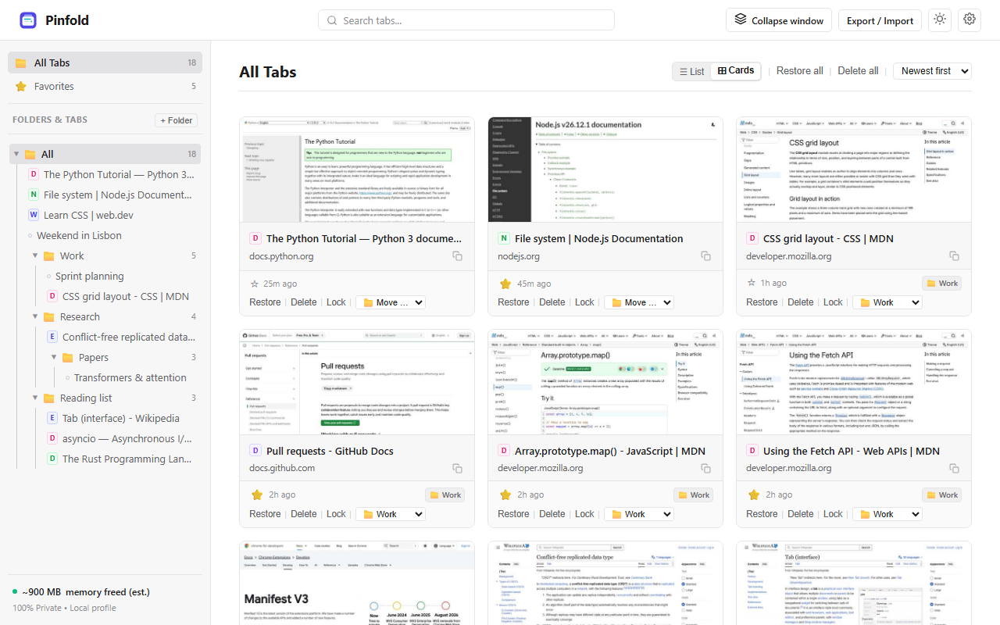

# Pinfold

A private, local-first tab manager for Chromium browsers.

**Website:** [pinfold.page](https://pinfold.page) · **Privacy policy:** [pinfold.page/privacy](https://pinfold.page/privacy) · **Contact:** [info@pinfold.page](mailto:info@pinfold.page)

**Install:** [Edge Add-ons](https://microsoftedge.microsoft.com/addons/detail/pinfold-private-tab-man/bhmddgchhmnnckoifdapdlfdimegnnej) · Chrome Web Store (coming soon) · [from source](#install)

[](https://developer.chrome.com/docs/extensions/develop/migrate/what-is-mv3)
[](LICENSE)

Pinfold closes the tabs you are not using and keeps them in a searchable, folder-organized list, so you can reopen them later. Everything is stored in your browser on your device. Nothing is sent anywhere.

*(A pinfold is a pen for rounding up strays.)*

Works in Chrome, Edge, Brave and other Chromium-based browsers.

<picture>
  <source media="(prefers-color-scheme: dark)" srcset="site/assets/cards-dark.png">
  
</picture>

---

## Features

**Saving tabs**
- Save tabs from the toolbar popup, the right-click menu, or keyboard shortcuts.
- Choose what to save: all tabs in the window, the current tab, tabs to the left, tabs to the right, or all tabs except the active one.
- Pinned tabs are left open by default (configurable).
- Excluded domains are never saved by the multi-tab actions. An entry like `example.com` matches that domain and its subdomains; an entry with a port, like `localhost:3000`, matches that host and port exactly.
- Incognito tabs are never saved.
- The toolbar icon shows a badge with the number of saved tabs.

**Dashboard**
- Nested folders and subfolders in a sidebar tree.
- List view and cards view.
- Search across tab titles, URLs and domains (case-insensitive substring match). Press <kbd>/</kbd> or <kbd>Ctrl</kbd>+<kbd>K</kbd> to focus the search box.
- Drag and drop to reorder tabs within a group, move tabs between groups, and move groups into folders.
- Star items to add them to the **Favorites** filter.
- Lock items to prevent them from being deleted.
- Rename tabs and folders with the pencil buttons; group titles can be edited inline.
- Sort by newest, oldest, most tabs, or name.
- Restore one item, a group, or everything. By default, restored tabs are removed from the list; you can choose to keep them instead. Locked items are always kept.
- Dark, light, or system theme.

**Page previews (optional, off by default)**
- Turn on "Capture Page Previews" in Options to show thumbnails in cards view.
- Turning it on asks Chrome for the optional "access all sites" permission, which screenshot capture requires.
- While it is on, saving tabs briefly switches to each tab to capture a low-quality JPEG thumbnail. Thumbnails are stored locally only.
- Previews are never included in exports or backups. Options has a button to delete all stored previews.

**Memory estimate**
- The sidebar shows a rough estimate of memory freed, based on about 50 MB per saved tab. Extensions cannot measure the real memory a tab used, so treat this number as a ballpark, not a measurement.

---

## Privacy

- No analytics, telemetry, or tracking.
- No remote scripts, fonts, or CDNs. All code ships inside the extension.
- Saved tabs, folders and settings are stored only in `chrome.storage.local` on your device.
- Favicons are read from the browser's local favicon cache. Pinfold does not request anything from the websites you saved.

See [PRIVACY.md](PRIVACY.md) for the full privacy policy.

---

## Permissions

| Permission | Why it is needed |
|---|---|
| `tabs` | Read the titles and URLs of open tabs so they can be saved, and close or reopen tabs. |
| `storage` | Store saved tabs, folders and settings locally in `chrome.storage.local`. |
| `unlimitedStorage` | Lift the default local storage quota so large collections of saved tabs (and optional previews) fit. |
| `contextMenus` | Add the Pinfold entries to the right-click menu. |
| `favicon` | Show site icons from the browser's local favicon cache, without contacting websites. |
| `<all_urls>` (optional host permission) | Only requested if you turn on page previews. Chrome requires it for `captureVisibleTab`, the API that takes the thumbnail screenshot. Not granted at install. |

---

## Install

- **Microsoft Edge:** [Get Pinfold from Edge Add-ons](https://microsoftedge.microsoft.com/addons/detail/pinfold-private-tab-man/bhmddgchhmnnckoifdapdlfdimegnnej)
- **Chrome Web Store:** coming soon (in review).

**Load unpacked (for development, or in other Chromium browsers until the Chrome listing is live):**

1. Clone the repository:
   ```bash
   git clone https://github.com/Tektrix/pinfold.git
   ```
2. Open the extensions page: `chrome://extensions` (Chrome, Brave) or `edge://extensions` (Edge).
3. Turn on **Developer mode**.
4. Click **Load unpacked** and select the cloned folder (the one containing `manifest.json`).
5. Optionally pin the extension to the toolbar.

---

## Keyboard shortcuts

| Windows / Linux | macOS | Action |
|---|---|---|
| <kbd>Alt</kbd>+<kbd>Shift</kbd>+<kbd>D</kbd> | <kbd>Command</kbd>+<kbd>Shift</kbd>+<kbd>D</kbd> | Save all tabs in the current window |
| <kbd>Alt</kbd>+<kbd>Shift</kbd>+<kbd>S</kbd> | <kbd>Command</kbd>+<kbd>Shift</kbd>+<kbd>S</kbd> | Save the current tab |
| <kbd>Alt</kbd>+<kbd>Shift</kbd>+<kbd>O</kbd> | <kbd>Command</kbd>+<kbd>Shift</kbd>+<kbd>O</kbd> | Open the dashboard |

In the dashboard: <kbd>/</kbd> or <kbd>Ctrl</kbd>+<kbd>K</kbd> focuses search, <kbd>Esc</kbd> leaves the search box or closes the import/export dialog.

The browser may not assign a suggested shortcut if another extension already uses it. You can change shortcuts at `chrome://extensions/shortcuts` (or `edge://extensions/shortcuts`).

---

## Import and export

Open **Import / Export** in the dashboard.

| Format | Export | Import | Notes |
|---|---|---|---|
| OneTab text | Yes | Yes | One `URL \| Title` per line; blank lines separate groups. Compatible with OneTab's import/export. |
| Markdown | Yes | Yes | `## Group` headings with `- [Title](URL)` links. |
| JSON backup | Yes | Yes | Groups and tabs: titles, URLs, dates, and starred/locked/pinned flags. Folders are not included (see Known limitations). |

Options also has a **Download Full Backup (JSON)** button.

Imports can be merged with your existing tabs or replace them. Imported items get fresh ids, and only `http`, `https`, `ftp`, `file`, `chrome`, `edge` and `brave` URLs are accepted.

---

## Known limitations

- **Folders are not included in backups.** JSON backups contain groups and tabs but not the folder tree or which folder a group belongs to. After importing a backup, everything lands at the root.
- **The memory number is an estimate** (about 50 MB per saved tab), not a measurement.
- **Previews slow down saving.** Chrome limits screenshots to about two per second, so saving many tabs with previews on takes a while, and you will see the tabs switch.
- **Search is substring matching**, not fuzzy search.
- **No sync.** Data stays in one browser profile on one device. Use export/import to move it.
- Excluded domains and the pinned-tab setting apply to the multi-tab actions. "Save the current tab" always saves the tab you asked for.
- Some browser-internal pages may refuse to reopen. Tabs that fail to open stay in your list.

---

## Development

There is no build step and no dependencies: plain JavaScript, HTML and CSS. Edit the files and click the reload icon for the extension on `chrome://extensions`.

```
manifest.json
background/service_worker.js   Context menus, shortcuts, saving and restoring tabs, preview capture, badge
dashboard/                     Dashboard page: folders, views, search, drag and drop, import/export dialog
popup/                         Toolbar popup with the save actions
options/                       Settings page
utils/storage.js               chrome.storage.local wrapper, settings defaults, URL safety checks
utils/export_import.js         OneTab, Markdown and JSON export and import parsing
utils/icons.js                 Inline SVG icons and small helpers
icons/                         Extension icons (16, 32, 48, 128 px)
generate_icons.js              Script that regenerates the PNG icons
test_pinfold.js                   Validation script (manifest, icons, network isolation, parsers)
tests/                         Unit tests (node:test)
```

Run the tests with Node.js:

```bash
node test_pinfold.js
node --test "tests/*.test.js"
```

`npm run package` builds the store zip in `dist/`.

The website in `site/` is static and is served at [pinfold.page](https://pinfold.page) by Cloudflare (`wrangler.jsonc`). After changing `PRIVACY.md`, run `npm run build:site` to regenerate `site/privacy.html`. Maintainers deploy the site with `npx wrangler deploy`.

---

## Contributing

Issues and pull requests are welcome. Start with [CONTRIBUTING.md](CONTRIBUTING.md) for setup, tests and the rules the code follows.

- New here? Pick an issue labeled [good first issue](https://github.com/Tektrix/pinfold/labels/good%20first%20issue).
- Everyone taking part follows the [Code of Conduct](CODE_OF_CONDUCT.md).
- Found a security problem? Report it privately as described in [SECURITY.md](SECURITY.md), not in a public issue.

---

## License

[MIT](LICENSE)
